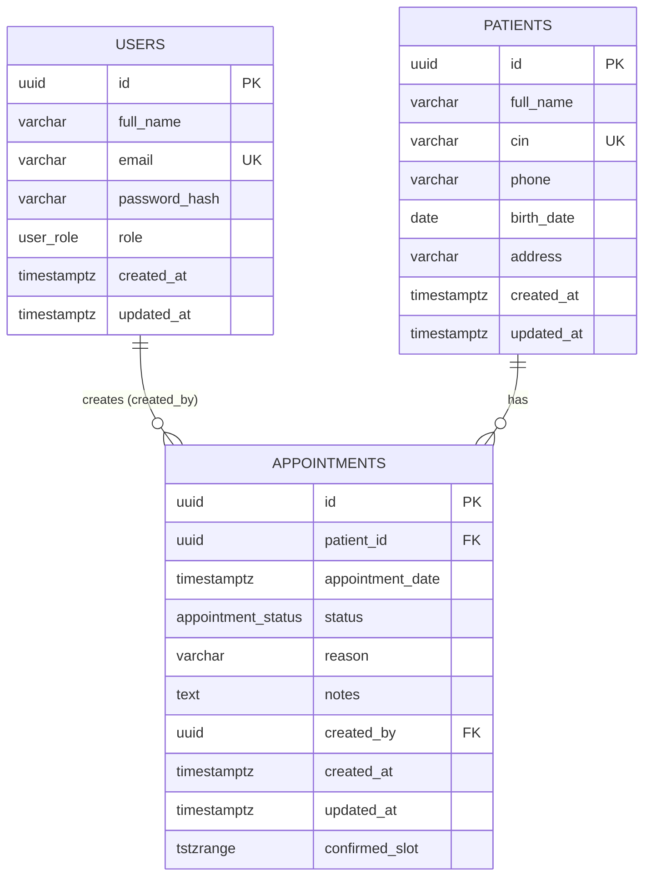

# ClinicFlow - Database Design

The canonical, executable schema lives in
[`backend/src/db/schema.sql`](../backend/src/db/schema.sql). It is an idempotent
migration: applying it repeatedly never deletes rows. A destructive local reset
is available in [`backend/src/db/reset.sql`](../backend/src/db/reset.sql).

## Entity-Relationship Diagram

## Relationships and justification

| Relationship | Cardinality | Justification |
| --- | --- | --- |
| `patients` -> `appointments` | 1-N | A patient can have many appointments over time, but each appointment belongs to exactly one patient. |
| `users` -> `appointments` | 1-N | A staff member or admin can create many appointments; every appointment stores the single user who created it (`created_by`). |

There is no N-N relationship in the mandatory scope. The only many-to-many
concept would be "users attend appointments", which is not required: staff
manage appointments but are not scheduled resources in this domain.

## Deletion rules

| Foreign key | Rule | Justification |
| --- | --- | --- |
| `appointments.patient_id` -> `patients.id` | `ON DELETE CASCADE` | An appointment has no meaning without its patient. Deleting a patient removes their appointment history and avoids orphan rows. |
| `appointments.created_by` -> `users.id` | `ON DELETE RESTRICT` | The creator is audit data. A user who created appointments must not be deleted while those records exist. |

## Constraints

- **UUID primary keys** on all tables (`gen_random_uuid()` from `pgcrypto`).
- **`patients.cin` is `UNIQUE`** (`patients_cin_unique`): the national identity
  number identifies exactly one patient.
- **`users.email` is `UNIQUE`** and has a basic format check.
- **PostgreSQL ENUM types**:
  - `user_role`: `admin`, `staff`
  - `appointment_status`: `pending`, `confirmed`, `cancelled`
- **Domain checks**:
  - `users.email` contains `@`
  - `full_name`, `cin`, `phone`, `reason` are `NOT NULL`
  - `patients.birth_date` is required
- **`appointments_no_confirmed_overlap`**: a GiST exclusion constraint that
  prevents two confirmed appointments for the same patient whose times are
  closer than 30 minutes.
- **`updated_at` triggers** keep modification timestamps accurate on every
  table.

## Indexes

| Index | Columns | Purpose |
| --- | --- | --- |
| `idx_patients_full_name` | `lower(full_name)` | Case-insensitive name ordering/search support |
| `idx_patients_cin` | `cin` | CIN search / lookup |
| `idx_patients_created_at` | `created_at DESC` | Default patient list ordering |
| `idx_appointments_patient_id` | `patient_id` | Patient appointment history and conflict checks |
| `idx_appointments_created_by` | `created_by` | Creator lookups / joins |
| `idx_appointments_appointment_date` | `appointment_date` | Date filters and today's stats |
| `idx_appointments_status` | `status` | Status filters and dashboard counts |
| `idx_appointments_date_status` | `(appointment_date, status)` | Common "day + status" filter |

Foreign-key columns are indexed because PostgreSQL does not create those
indexes automatically.

## 30-minute business rule

Rule: **a patient cannot have two confirmed appointments within a 30-minute
window**.

It is enforced twice:

1. **Application layer** (`appointment.service.js`)
   - The patient row is locked with `SELECT ... FOR UPDATE` inside a
     transaction. All confirmation paths (`POST /api/appointments` with
     `status=confirmed` and `PATCH /api/appointments/:id/status` to
     `confirmed`) take this lock.
   - The service queries for another confirmed appointment for the same patient
     in `(appointmentDate - 30min, appointmentDate + 30min)`.
   - Locking serializes concurrent requests for the same patient, so two
     simultaneous confirmations cannot both pass the check.
2. **Database layer** (safety net)
   - A trigger stores `[appointment_date - 15min, appointment_date + 15min)` in
     `confirmed_slot` only when the status is `confirmed`.
   - A GiST exclusion constraint rejects overlapping slots for the same
     patient. Two slots overlap exactly when the appointments are less than
     30 minutes apart.
   - Two appointments exactly 30 minutes apart are allowed, matching the
     application check.

## Why `confirmed_slot` is materialized

`timestamptz - interval` is timezone-dependent and therefore `STABLE`, which
means PostgreSQL cannot use it directly in an index or exclusion constraint.
The trigger materializes the range in a real column so the GiST exclusion
constraint can be enforced by the database.
